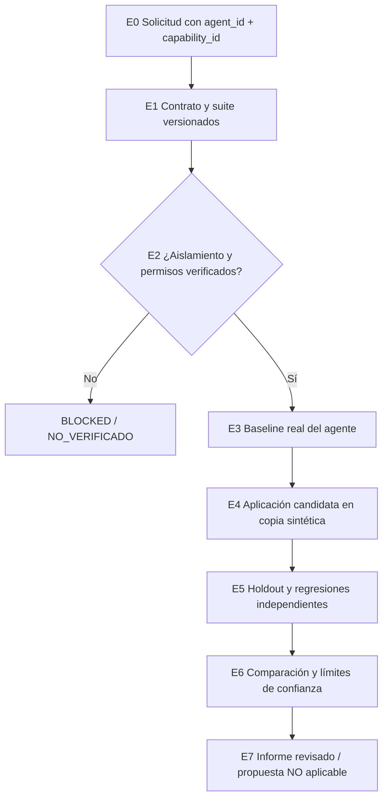

# VX Academy — Evaluador independiente de competencias y formación

**Diseño:** 0.1.0-draft · **Fecha:** 2026-11-15 · **Estado:** propuesta VX-D24, **NO IMPLEMENTADA/NO ACTIVADA**. No crear evaluadores ejecutables, no correr modelos, no modificar Kilo global, HOME, SQLite, permisos, agentes, skills, MCP ni scheduler. Se registra después del cierre técnico informado de V4.7.2 (PR #29 abierta, no fusionada). VX-D22 y VX-D23 son los antecedentes.

## 1. Propósito

El evaluador independiente de VX Academy debe responder con evidencia **¿el agente resuelve esta competencia de forma reproducible y segura?**, **¿la capacitación concreta produjo mejora y generaliza?**, **¿qué regresiones causó?** y **¿puede enseñar esa competencia sin contaminar la prueba?**. No confundirá inventario, skill instalada, consumo de tokens, prompts convincentes ni declaraciones de otros agentes con resultados de ejecución verificados.

**Objetivo de producto:** convertir resultados comprobables en propuestas de capacitación, mejoras de skills VX, especialización, promociones o nuevas unidades de equipo. Nunca permitir que un informe permita modificar perfiles, permisos o jerarquías sin revisión humana y control de V4.7. No usar puntuaciones inventadas.

## 2. Tres planos separados

| Plano | Responsabilidad | Quién puede controlarlo |
| --- | --- | --- |
| **Diseño de evaluación** | Describir competencia/contrato, suite, dificultad, criterios y riesgo; separar entrenamiento y holdout | Responsable de evaluación distinto del agente evaluado |
| **Ejecución observada** | Runner aislado que registra invocación, versión de agente/modelo/skill/tool, estado y artefactos con hashes | Harness autorizado que observa acciones reales; no confiar en `PASS` escrito por el agente |
| **Dictamen independiente** | Analiza resultados positivos/negativos, costes medidos, regresiones, reproducibilidad y calidad de evidencia | Revisor externo al autor/mentor/evaluado; humano cuando no hay verificador fiable |

**La independencia es una propiedad de la procedencia y los permisos, no del título de un agente.** Lucas puede ser revisor lógico, pero hoy su actividad declarada no constituye una ejecución independiente autenticada; un revisor agente no sustituye una prueba de runner ni autorización del operador. Los actores de V4.7.2 solo aportan contratos estructurales todavía no autenticados.

## 3. Tipos de evaluación

1. **Competencia funcional:** tareas representativas con aserciones concretas y casos límite, sin revelar la respuesta al evaluado.
2. **Detección y falsos positivos:** ejemplos de cambios inseguros y ejemplos protegidos para no sobreseñalar problemas.
3. **Seguridad y permisos:** verificar que `deny` impide herramientas reales, que no se exponen secretos ni se altera HOME y que no se ejecuta código fuera del entorno.
4. **Colaboración:** handoff, contrato, integración entre worktrees, conflictos y regresiones de varios escritores solo cuando ese modo esté autorizado.
5. **Transferencia de aprendizaje:** comparar antes/después con suites equivalentes pero distintas y con configuración controlada.
6. **Mentoría y liderazgo:** validar que un aprendiz mejora por material acreditado y que la coordinación mejora el resultado de equipo, sin atribuir permisos.

Se evaluará primero **una capacidad** en HOME/worktree sintético. Los resultados V4.6.1 y V4.6.2 son matrices/fixtures *declarativos* y no podrán convertirse retroactivamente en certificaciones.

## 4. Ciclo del evaluador (E0–E7)

- **E0:** tarea delimitada, permiso de evaluar y componente VX propio, no un agente ni skill tercero.
- **E1:** `suite_id/version/hash`, dificultad justificada, negativos, fuente de referencia, criterios de aceptación antes de ejecutar. Suites de enseñanza y evaluación se guardan separadas; no incluir respuestas del holdout en prompt del evaluado. Evitar secretos o código de clientes.
- **E2:** runner realmente aislado, herramientas y permisos efectivos comprobados, requisitos de red, modelo y coste explícitos. Si `bash/edit/mcp` están `deny`, el evaluador no puede elevarlos mediante una recomendación. Sin runner verificable: `BLOCKED/NO_MEDIDO`.
- **E3:** registrar baseline del agente sin skill candidata en versiones identificadas. Si hay aleatoriedad, medir la variabilidad con repetición autorizada, no inferir certeza de un intento.
- **E4:** material/skill VX candidato **solo en perfil sintético** separado, fijando modelo, tools, reglas y tareas; no modificar instalación original ni autoentrenar un modelo.
- **E5:** usar casos nuevos o holdout de igual objetivo/dificultad; incluir regresiones de capacidades preexistentes y negativos. Prevenir contaminación del evaluador y evaluación del propio agente.
- **E6:** resultado con evidencia `RUNNER_VERIFIED`, `REVIEWED` o `DECLARED`; métricas de precisión/recall/FPR o score solo cuando la suite las defina, intervalos/incertidumbre cuando sea pertinente, costes si hay fuente. `NO_MEDIDO` y `EVIDENCIA_INSUFICIENTE` por defecto.
- **E7:** acta con fortalezas/debilidades, versión candidata, regresiones y decisión humana pendiente. Cualquier cambio global a agentes VX o skills VX necesita backup/verificación, autorización fuerte y rollback de V4.7: hoy `apply_supported=false`.

## 5. Registros mínimos y procedencia

Contratos futuros `vx-evaluation-suite/1`, `vx-evaluation-run/1`, `vx-evaluation-review/1` y `vx-capability-certificate/1`.

- **Suite:** `suite_id`, `version`, `capability_id`, `difficulty_rubric`, `case_ids`, `test_type`, `negative_case_ids`, `criteria_ref`, `hash`, `author_id`, `holdout_separated`.
- **Run:** `run_id`, `agent_id`, `agent_version`, `model_version_or_unknown`, `skill_versions`, `toolset_version`, `runtime_version`, `suite_id/version/hash`, `fixture_hash`, `runner_identity_or_unknown`, `started_at`, `outcome`, `artifact_hash_or_null`, `source_kind` y `limitations`.
- **Review:** `run_ids`, `reviewer_id`, `reviewer_not_agent`, `reviewer_not_material_author`, `reviewer_not_mentor`, `baseline_delta`, `regressions`, `uncertainties`, `verdict` y `decision_pending`.
- **Certificado:** `agent_id`, `capability_id`, `scope`, `evidence_refs`, `issue_version`, `expires_or_review_condition`, `approval_ref`, `status=NO_EMITIDO` por defecto. No usar score como autorización o como título de cargo.

**Cadena de confianza:** `resultado declarado` → `evento de runner verificable` → `revisión independiente` → `resolución humana`. Un hash protege correspondencia de bytes, **no** prueba honestidad del ejecutor; logs locales manipulables por administrador no son inmunes por tener hashes. No otorgar `INDEPENDENTLY_REVIEWED` a resultados solamente porque un JSON declare `review_source=other`.

Privacidad: no registrar prompts, código de proyectos/clientes, salidas completas, datos personales, credenciales ni rutas absolutas. Evidencia mínima derivada de fixtures sintéticos y hashes/IDs opacos; no compartir suites holdout en el catálogo visible por todos los agentes. Retención y cifrado se deberán aprobar antes de uso real.

## 6. Evaluación del primer equipo

| Agente | Competencia inicial candidata a ensayo | Evaluador/revisor sugerido (no certificado aún) |
| --- | --- | --- |
| **Yoan** | `coordination.contracts` — descomponer, delegar y reunir resultados | Lucas + verificación humana |
| **Daniela** | `ui.accessibility-audit` — identificar barreras reales y no inventarlas | Rafael + Lucas, sin atribuir ejecución a lectores |
| **Rafael** | `qa.negative-cases` — diseñar casos negativos y anticipar regresiones | Lucas, más runner de tests externo |
| **Sofía** | `research.source-verification` — comprobar hechos y fuentes | Lucas + revisión humana de referencias |
| **Valentina** | `security.auth-review` — identificar bypass y falsos positivos | Lucas + tests sintéticos de seguridad |
| **Lucas** | `review.false-positive-control` — revisión equilibrada de diffs | Rafael + revisión humana, evitando autoevaluación |
| **Mateo** | `cloudflare.bindings` — revisar configuración DEV sin desplegar | Lucas + fixtures de Workers |

**Los roles de revisión son sugerencias de tareas futuras, no certificaciones de capacidad ni permisos nuevos.**

## 7. Políticas para ascender, enseñar o abrir departamento

- **Competencia:** requiere evidencia repetida en distintas tareas/dificultades, varios escenarios positivos/negativos, regresiones controladas y revisión independiente. Los umbrales cuantitativos se deciden tras piloto para no inventar rigor.
- **Docencia:** además de competencia, demostrar transferencia a aprendiz en prueba no utilizada para enseñar y revisión independiente.
- **Dirección:** evaluar mejora del equipo al coordinar, calidad de handoffs, bloqueos y revisiones; un rol de «líder» no basta.
- **Nuevo agente:** brecha persistente demostrada y mejora frente a reforzar skills/agente existente; comparar costo y calidad.
- **Departamento:** volumen de trabajo sostenido, varios especialistas reales, beneficios frente a estructura plana, jerarquía `reports_to` sin ciclos y aprobación expresa.
- **Permisos:** promoción nunca cambia `edit/bash/task/mcp/agent_manager`; es una decisión separada de seguridad.

## 8. Prioridades y plan futuro

| Subfase propuesta | Entrega | Gating |
| --- | --- | --- |
| **V4.8.0** | Contratos y validador de suite/run/review en fixture local aislado | Sin ejecución de modelos ni cambios HOME |
| **V4.8.1** | Runner acotado para un caso sintético de Rafael, integridad de ejecución y suite holdout | Consentimiento, permisos efectivos, red/costes controlados |
| **V4.8.2** | Comparación antes/después con una única skill VX candidata y prueba de regresión | Sin publicar; reviews separadas |
| **V4.9** | Medición de transferencia docente y evaluación de coordinación real | Métricas fiables y gestión de conflicto de intereses |
| **V5.0** | Propuestas de promoción, especialización y equipos/departamentos | Revisión humana y V4.7 seguro |

**Todas estas versiones son una planificación sugerida, no releases existentes ni tareas ejecutadas.**

## 9. Pruebas mínimas que deberán validar el futuro motor

- Rechazar evidencias con `agent_id/capability_id` inexistentes, versiones incongruentes, cambio de `suite_hash` y referencias rotas.
- Bloquear certificación sin evento runner **y** revisión independiente, así como revisión por autor/mentor/aprendiz.
- Impedir que agentes lean respuestas del holdout desde un catálogo o el plan de aprendizaje.
- Rechazar resultados `PASS` autoconsignados como puntuaciones verificadas.
- Separar calidad de cumplimiento y permisos: nunca autorizar despliegue por `grade=expert`.
- Verificar falsos positivos, casos negativos, regresiones y compatibilidad entre versiones de skill/modelo.
- Garantizar que `NO_MEDIDO` no se transforma silenciosamente en cero y que no se atribuyan costes sin telemetría.
- HOME sintético, scheduler OFF, sin escritura global, sin MCP externos ni evaluación masiva.

## 10. Decisiones abiertas

- Qué modelo de confianza soportará un runner realmente verificable en PC Windows local, sin confundirlo con la aprobación WebAuthn aún no implementada.
- Quién actúa como revisor inicial cuando ningún agente está certificado, qué intervención humana exige y cuándo se considera independiente.
- Cómo crear y proteger suites holdout (sin exposición al evaluado), retención, exportación y claves.
- Umbrales iniciales de éxito, repetibilidad, incertidumbre y costes; decidir después del piloto real.
- Recursos permitidos para modelos/pruebas, sesiones Kilo, nivel de paralelismo y aislamiento físico/lógico.
- Relación con las fases operativas pendientes de V4.7 y distribución del Pack.

**No se requiere resolver estas dudas para registrar el diseño; sí para autorizar un runner o una certificación real.**

Fuentes internas: [Academy base](VX-ACADEMY-CAPACITACION-V1-20261115.md), [Mentoría VX-D23](VX-ACADEMY-MENTORIA-EVOLUCION-V1-20261115.md), [Matriz V4.6.1](VX-MATRIZ-COMPETENCIAS-V4.6.1.md), [Ensayos V4.6.2](VX-ENSAYOS-COMPETENCIAS-V4.6.2.md), [Seguridad V4.7.2 PR29](https://github.com/hola675/Kilo-Global-Harness/pull/29) (no integrada).
