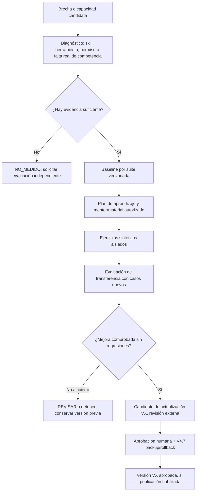

# VX Academy — Mentoría, aprendizaje verificable y evolución de equipos

**Versión de diseño:** 0.1.0-draft · **Fecha:** 2026-11-15 · **Estado:** PROPUESTA, sin ejecución. Vinculada a **VX-D23 (propuesta)** y VX-D22 (objetivo registrado). **No habilitar carga de skills, herramientas, permisos, formación automática, HOME, MCP, scheduler, edición de agentes ni publicación.**

## 1. Propósito y alcance

Convertir VX Academy en el mecanismo mediante el cual un agente VX **adquiere competencias medibles**, mediante formación revisada, sin mantener conocimiento redundante en todos los agentes ni permitir autoascensos. Capacitación = mejora de instrucciones, skill VX, referencias, plan de pruebas, uso permitido de herramientas y selección contextual **tras comparación real**; NO reentrenamiento de pesos del LLM, memoria autobiográfica sin pruebas, ingestión de conversaciones privadas, descarga de terceros ni instalación automática.

La política **VX-D14** limita la formación y gobierno a **componentes VX propios**. Una skill externa, un MCP existente o el agente built-in `code` de Kilo puede servir como dependencia autorizada en una tarea, pero VX no adquiere propiedad ni derecho de actualización sobre él. Las identidades de personas IA son alias, no usuarios autenticados.

## 2. Cuatro funciones independientes

| Función | Entrega y contrato | Qué NO puede hacer |
| --- | --- | --- |
| **Especialista / ejecutor** | Entrega de tarea con diff, tests y evidencias | Declarar su propio nivel de experiencia, elevar permisos |
| **Mentor (candidato/validado por competencia)** | Material VX versionado, lecciones, ejercicios y retroalimentación | Ser evaluador único de su propia clase, editar el prompt del aprendiz |
| **Evaluador independiente** | Suite de evaluación no divulgada durante la formación, dictamen y comparación | Entrenar sobre casos de evaluación, autocertificarse |
| **Supervisor de equipo** | Coordinación, prerequisitos, carga de tareas, selección de responsables y escalación | Conceder permisos de Kilo, reemplazar aprobación humana, crear departamentos por inercia |

Un rol administrativo `reports_to` no implica `may_teach`; una relación `mentors` no implica `reports_to`; una relación de `reviews` no añade herramientas. El operador conserva las autorizaciones efectivas.

## 3. Ciclo de vida de una capacitación

### Puertas detalladas

**G0. Descubrimiento y pertinencia.** La solicitud menciona `agent_id`, `capability_id`, versión, motivo verificable, alcance y tareas concretas. Se distingue falta de skill, de instalación, de herramienta conectada, de permiso, de datos correctos o de competencia. Un mensaje del agente que diga «necesito entrenamiento» es **hipótesis**, no prueba.

**G1. Línea base.** Un evaluador habilitado establece suite reproducible de tareas representativas, incluyendo negativas y regresiones. Se guardan únicamente metadatos/huellas sin datos de proyectos ni respuestas completas. Si no hay ejecución independiente verificable: `NO_MEDIDO`; V4.6.2 sintético es comparador declarativo, no certificado.

**G2. Selección.** Elegir la intervención **más pequeña**: mejorar descripción de skill, una referencia, una instrucción de rol, un ejemplo sintético, una herramienta opcional o creación de skill VX candidata. Antes de crear skill/agente/departamento, comparar con reutilización de material actual. El catálogo de currículo no instala nada ni amplía permisos.

**G3. Docente.** Mentor con cualificación *verificada para esa capacidad* y versión vigente, o material auditado sin mentor certificado. Al inicio **todos los agentes VX carecen de enseñanza verificada**; los siete son candidatos únicamente. Cuando no existe mentor certificado, usar material sometido a revisión independiente y un responsable humano de la evaluación: nunca atribuir título de mentor ficticio.

**G4. Ensayo.** Ejecutar exclusivamente en HOME y repositorio sintéticos aprobados, con snapshots de `agent_version/model_version/skill_version/toolset/runtime`; material didáctico y casos de evaluación separados para evitar memorización. Mantener permisos de Kilo y exclusión de secretos. La futura enseñanza entre dos agentes es **un protocolo de entrega de material y feedback**, no acceso directo al archivo de configuración del aprendiz.

**G5. Transferencia.** Suite distinta de la formación, con misma dificultad/criterios objetivos y revisión por quien **no elaboró ni impartió** el contenido. Comprobar también posibles regresiones en habilidades previas. La formación solo es éxito cuando hay evidencia trazable de mejora, no por haber completado la lección. Umbrales cuantitativos exactos permanecen pendientes de piloto.

**G6. Promoción/publicación.** El resultado produce `training_result` o `skill_change_candidate` en estado pendiente. Una promoción profesional no es un `allow` técnico. Publicar una skill/agent VX global necesita **autenticación real + respaldo verificable + rollback + aprobación específica** de V4.7; hoy `approval_granted=false` y `apply_supported=false`.

**G7. Reevaluación.** Una cualificación depende de versiones, tarea y evidencia; si cambian el modelo, herramienta, skill o comportamiento del runtime significativamente, marcar `NECESITA_REEVALUACION`, sin degradar arbitrariamente al agente. No programar revisiones automáticas hasta decisión posterior de scheduler.

## 4. Selección de mentor: matriz independiente

El candidato a mentor para una capacidad debe satisfacer **todas** las condiciones:
- `agent_id` VX propio y capacidad explícita versionada;
- resultados reproducibles de la **misma** competencia en varias tareas y con casos negativos;
- revisor independiente y sin conflicto de autoría;
- material formativo auditado/versionado y apto para compartir;
- transferencia anterior observada en al menos un aprendiz y posteriormente repetida, cuando se pretenda reconocimiento formal de **docente**;
- capacidad para acompañar la formación sin traspasar herramientas, secretos, permisos ni acceso de terminal al aprendiz.

**Candidato a mentor** no es **mentor certificado**; **experto en una habilidad** no significa **buen profesor**; **mentor** no significa **jefe de departamento**. Si no hay mentor calificado, el resultado será `MENTOR_NO_DISPONIBLE` y podrá proponerse un módulo de formación auditado para revisión humana.

### Ejemplo ilustrativo, no evento real

Daniela tiene currículo de auditoría de accesibilidad. Puede recibir un módulo de diseño de pruebas de interfaz cuyo *material* haya sido revisado por Rafael y cuyo *resultado* se verifique independientemente por Lucas en una suite nueva. **Actualmente ninguno de los tres está certificado como docente ni como evaluador independiente con ejecución acreditada**: esto es un flujo futuro y no implica que Rafael pueda escribir tests ni que Daniela pueda ejecutar Playwright hoy.

## 5. Grafo de aprendizaje, evaluación y organización

Se modelan **aristas tipadas**, con límites independientes:

- `needs_capability(agent, capability)`: brecha propuesta, no competencia demostrada;
- `can_access_material(agent, curriculum)`: referencias de material, sin carga ni permiso automático;
- `mentors(teacher, learner, capability)`: solo con evidencia/consentimiento; dirigida y versionada;
- `assesses(reviewer, learner, case_suite)`: independiente del autor del contenido y del aprendiz;
- `prerequisite_of(capability_A, capability_B)`: grafo DAG, sin ciclos;
- `reports_to(agent, leader)`: DAG de supervisión, sin ciclos;
- `collaborates_with(agent_A, agent_B)`: grafo de trabajo bidireccional, ciclos permitidos.

La **selección de tareas** prioriza especialidades demostradas. La **selección de mentor** busca competencia y cualificación pedagógica, no solo relación jerárquica; puede ser interdepartamental sin mover al aprendiz de departamento.

### Departamentos/escuelas futuras

Se pueden formar comunidades funcionales de práctica (UX, QA, seguridad, infraestructura) como catálogos compartidos sin crear jefaturas ni adjuntar todas las skills. Crear unidad organizativa real solo tras demanda sostenida, beneficio medido respecto de coordinación plana, evaluación de dependencias, revisión y aprobación del operador. No atribuir madurez ni seniority por número de subordinados.

## 6. Modelo de datos de una actividad: privacidad y trazabilidad

**Esquemas futuros:** `vx-learning-plan/1`, `vx-learning-session/1`, `vx-learning-evaluation/1`, `vx-teaching-qualification/1`. Cada documento apunta a `agent_id`, `capability_id`, versiones/hashes, `scenario_id`, `source_kind`, `reviewer_id` y estado; no al texto completo de las sesiones. `evidence_ref` es ID opaco o hash, no URL de secretos.

- `training_plan`: agente, habilidad, brecha declarada/observada, `mentor_id?`, `material_version`, pruebas de transferencia, límites de acceso y salida esperada.
- `learning_session`: IDs y versiones, acciones permitidas, lección completada, resultado de ejercicios y referencia a revisión.
- `learning_evaluation`: suite holdout, comparación baseline/candidato, regresiones, versión del evaluador, estado de revisión y razón; ningún `PASS` autoreportado se toma como verificado.
- `teaching_qualification`: mentor, capacidad, material, evaluaciones independientes de transferencia, vigencia y responsable de revisión.

Estados de planes: `DETECTADO → EVALUACION_PENDIENTE → PLAN_PROPUESTO → REVISION_OPERADOR → AUTORIZADO_EN_AISLADO → ENSAYADO → TRANSFERENCIA_EVALUADA → EVIDENCIA_VERIFICADA → CANDIDATO_DE_VERSION → PUBLICADO` (último **NO DISPONIBLE**). Estados alternativos `NO_MEDIDO / BLOQUEADO / DESCARTADO / NECESITA_REEVALUACION`. Las transiciones son **conceptuales**, no un workflow implementado.

## 7. Calidad de la capacitación: métricas que sí y que NO

| Indicador | Fuente válida | Mal uso que se prohíbe |
| --- | --- | --- |
| Cobertura de tareas por capacidad | Suite versionada independiente, positiva y negativa | Número bruto de skills instaladas |
| Mejora frente a línea base | Misma dificultad, casos nuevos, versión de modelo/herramientas fijada | Comparar prompts/modelos distintos y atribuir todo a la skill |
| Regresiones en habilidades existentes | Conjunto de pruebas previas con ejecuciones contrastadas | Declarar éxito por una sola respuesta buena |
| Transferencia a aprendiz | Evaluación ciega, revisor distinto del mentor | Tomar autorreporte de mentor como evidencia |
| Eficiencia | Latencia, tokens/coste y uso de herramientas **si se dispone de telemetría real** | Inventar coste o deducir capacidad desde errores de sesión |
| Salud del equipo | Handoffs útiles, conflictos de integración, trabajo retrabajado, bloqueo | Contratar agentes porque el grafo “se ve pequeño” |

No se fija un porcentaje arbitrario de aprobación. Los resultados de V4.6 son inventario/declaraciones, no medición de desempeño; toda evidencia nueva empieza en `SIN_EVALUAR`, `NO_MEDIDO` o `EVIDENCIA_INSUFICIENTE` hasta existir un runner y revisión independientes.

## 8. Propuesta de piloto escalonado (SIN EJECUCIÓN)

**P0. Solo diseño:** validar schemas referenciales, causalidad, separación de roles y no activar permisos en el registro de propuestas.

**P1. Ficha de currículo mínima:** un solo agente VX (p. ej. Rafael para `qa.negative-cases`), con material sintético y suite de casos no públicos. Registro de baseline sin usar el prompt completo ni artefactos de clientes.

**P2. Intervención didáctica:** comparar material versión A vs B con el mismo modelo/herramientas en fixtures aislados. Si no existe mentor cualificado, usar únicamente contenido revisado y no llamarlo docencia certificada.

**P3. Evaluación de transferencia:** revisor independiente observa si se generaliza y si hay regresiones, y compara el valor añadido frente a no usar Academy.

**P4. Propuesta de skill/papel:** si mejora y es mantenible, generar candidato versionado; no modificar herramientas ni publicar hasta V4.7 final y aprobación separada.

**P5. Escalado condicionado:** repetir en distintas competencias y equipos; optimizar currículos y crear mentorías cross-team solo con evidencia. No introducir scheduler ni autoasignación opaca.

## 9. Reglas de seguridad y dependencias

- Las **skills** en Kilo pueden ser genéricas o del mismo pool con descripción/política de carga según modo/cliente. La visibilidad por agente **no es una ACL** y debe verificarse por versión de Kilo. Se usan skills VX versionadas, material didáctico en referencias y selección precisa; no instalar todas las skills por agente ni incluir scripts remotos no auditados.
- `permission: allow|ask|deny` se resuelve por Kilo; Academy **no puede elevar `edit/bash/task/mcp/agent_manager`**. Un docente no transfiere permisos ni corre shell por su estudiante.
- Planes/mentores evaluados no actualizan SQLite privada o HOME automáticamente; guardar mínimo dato local solo cuando exista política y operación autorizada.
- No usar modelos/API externas ni servicios de pago para «entrenar» sin solicitud; no generar ciclos de mejora autojustificados por evaluación de sí mismos.
- Una clase completada puede indicar `LECCION_COMPLETADA`, no `CAPACIDAD_VERIFICADA`. Ningún título profesional es permiso operativo.

## 9.1. Evidencia que deberá aportar el evaluador VX-D24

El [evaluador independiente V4.8.0 propuesto](VX-ACADEMY-EVALUADOR-INDEPENDIENTE-V1-20261115.md) formaliza baseline, suite holdout, tests negativos y regresiones para decidir si una mentoría transfiere una competencia. No se usa `mentor_id` o `review_source=other` declarado como evidencia sin runner y revisión externa. El [contrato de diseño](../registry/vx-academy-independent-evaluator-v1.proposal.json) mantiene cero runs y cero certificados. La tutoría no puede modificar permisos ni publicarse automáticamente.

## 10. Decisiones todavía abiertas

Confirmar por separado: **nomenclatura del programa (VX Academy)**, ubicación y vida del historial formativo, forma de cualificar al primer mentor sin aprendiz certificado, procedimiento de revisión externa (human/runner), umbrales tras piloto, qué herramientas se permiten por curso y si la enseñanza tendrá que autorizarse en cada caso. Ninguna de ellas se infiere de «continúa».

## Fuentes y coherencia

- [VX Academy base](VX-ACADEMY-CAPACITACION-V1-20261115.md) y [catálogo v1 inactivo](../registry/vx-academy-catalog-v1.proposal.json).
- [Matriz V4.6.1](VX-MATRIZ-COMPETENCIAS-V4.6.1.md) y [ensayos V4.6.2](VX-ENSAYOS-COMPETENCIAS-V4.6.2.md), ambos sin certificación real.
- [Personas y organización](VX-PERSONAS-RELACIONES-V1-20261115.md), [permisos/autonomía](VX-PERMISOS-Y-AUTONOMIA-V1-20261115.md) y [roadmap](VX-EVOLUTION-ROADMAP.md).
- [Kilo Skills](https://kilo.ai/docs/customize/skills), [Kilo Permissions](https://kilo.ai/docs/customize/agent-permissions) y [Anthropic long-running harness](https://www.anthropic.com/research/effective-harnesses-for-long-running-agents). Se usan como referencias conceptuales, no se importa código.
